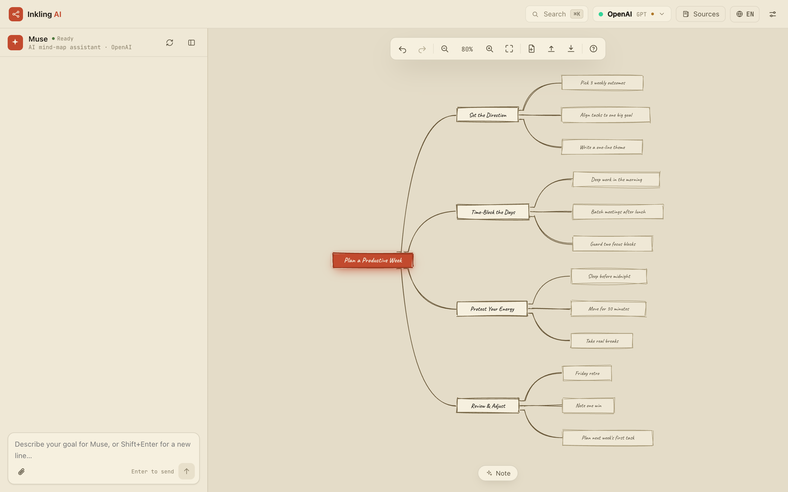

[Portfolio](https://markxian.cn/?ref=github-profile) · [Inkling](https://inkling.markxian.cn/?ref=github-profile) · [Say hello](mailto:mark-xian@foxmail.com)

I'm Mark, an AI product engineer in Guangdong, China. I build visual tools that turn documents and ideas into things people can work with.

## Building Inkling

**[Inkling](https://inkling.markxian.cn/?ref=github-profile)** — an AI mind-mapping canvas. Muse turns PDFs into editable maps and builds on the changes you make by hand.

*Inkling workbench · sample weekly plan. Tap to view full size.*

**[Join the private beta →](https://inkling.markxian.cn/?ref=github-profile)**

## Selected work

**[MindGeniusAI](https://github.com/xianjianlf2/MindGeniusAI)** Self-hostable document-to-mind-map agent with RAG.

**[gpt-image-2-tools](https://github.com/xianjianlf2/gpt-image-2-tools)** Bring-your-own-key image generation and editing. [Try it →](https://image.markxian.cn/?ref=github-profile)

**[apidoc2MCP](https://github.com/xianjianlf2/apidoc2MCP)** Turn API documentation into MCP service definitions.

## Open-source activity

Selected contributions to the tools I use, from agent interfaces to JavaScript internals.

| Project | Contribution |
| :-- | :-- |
| [Orca](https://github.com/stablyai/orca/pull/7815) Merged | Hide stale merged PRs when a workspace moves to new commits |
| [LangChain.js](https://github.com/langchain-ai/langchainjs/pull/11498) Merged | Let human reviewers respond on behalf of tools |
| [Immer](https://github.com/immerjs/immer/pull/1320) Open | Preserve sparse-array behavior in optimized filters |
| [Effect](https://github.com/Effect-TS/effect/pull/6316) Merged | Preserve interruption and timeouts in cached effects |

[All open PRs →](https://github.com/search?q=author%3Axianjianlf2+is%3Apr+is%3Aopen&type=pullrequests) · [Merged contributions →](https://github.com/search?q=author%3Axianjianlf2+is%3Apr+is%3Amerged&type=pullrequests)

<!-- Maintenance: keep 3 selected projects and at most 4 contribution rows, with one PR per row.
Replace highlights as work progresses; use the GitHub queries for full history.
Do not append activity archives, nested tables, badge walls, or date-only refreshes. -->

## More about me

I rebuild tools to understand their internals: [super-agent](https://github.com/xianjianlf2/super-agent) explores tool calling, MCP, and session memory; [mini-vue](https://github.com/xianjianlf2/mini-vue) and [mini-react](https://github.com/xianjianlf2/mini-react) explore UI frameworks.

**Toolbox** · TypeScript · React · Hono · Python · MCP · Cloudflare

---

[Writing on Juejin](https://juejin.cn/user/4495219058030952) · [More projects](https://github.com/xianjianlf2?tab=repositories)

<!-- Invisible profile-view counter; renders as nothing. -->

